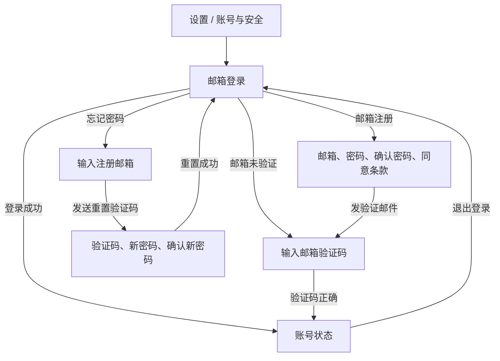

# Cwhale 邮箱账号流程与服务端接口方案

状态：邮箱账号客户端与 API 已部署，另提供登录后可选的服务器代管任务队列。/v1/auth/ 和 /v1/generation/ 通过现有 HTTPS/Nginx 转发到同一独立 systemd 服务；账号认证单独使用时不接收聊天。生成队列只处理用户明确启用代管的当前窗口任务。客户端通过构建参数配置服务 HTTPS 地址，不在源码中硬编码服务主机名。

## 数据边界

- 账号服务器只保存注册邮箱、密码哈希、邮箱验证状态、账号状态、验证码挑战和会话撤销信息。
- 明文密码只在用户提交时通过 HTTPS 发给账号服务器，不写入本机存储、日志、聊天记录或模型 API。
- 聊天、摘要、窗口记忆、全局记忆、模型 API Key、生成文件都继续保存在本机；登录不会上传或同步这些数据。
- 客户端只把轮换后的 refresh token 存在系统安全存储；access token 只驻留内存。退出登录会请求服务器撤销 refresh token，并清除本机 refresh token。
- 账号服务器地址通过 `--dart-define=CWHale_AUTH_BASE_URL=<账号服务 HTTPS 地址>` 配置。客户端只接受 HTTPS。

## 用户流程



登录不作为本地聊天的启动门槛。正式 Android 和 Windows 包均配置账号服务，用户可以从首次引导或设置进入账号页面；未配置端点的本地开发构建会显示未接入提示。退出账号不清除任何本机聊天数据。

## HTTP API 约定

所有请求使用 JSON、HTTPS 和统一响应格式。建议错误响应为 `{"code":"INVALID_CODE","message":"验证码无效或已过期"}`。成功响应字段如下；服务器可以增加字段，但不要更改已有字段含义。

| 方法与路径 | 请求字段 | 成功响应 |
| --- | --- | --- |
| `POST /v1/auth/register` | `email`, `password` | `challengeId`, `retryAfterSeconds`, `expiresInSeconds` |
| `POST /v1/auth/email/verify` | `challengeId`, `code` | 登录会话对象 |
| `POST /v1/auth/email/resend` | `challengeId` | `retryAfterSeconds`, `expiresInSeconds` |
| `POST /v1/auth/login` | `email`, `password` | 登录会话对象 |
| `POST /v1/auth/password-reset/request` | `email` | 不论邮箱是否存在都返回同格式的 `challengeId`, `retryAfterSeconds`, `expiresInSeconds` |
| `POST /v1/auth/password-reset/resend` | `challengeId` | `retryAfterSeconds`, `expiresInSeconds` |
| `POST /v1/auth/password-reset/confirm` | `challengeId`, `code`, `newPassword` | `{"success":true}` |
| `POST /v1/auth/token/refresh` | `refreshToken` | 登录会话对象，返回轮换后的 refresh token |
| `POST /v1/auth/logout` | `refreshToken` | `{"success":true}` |

登录会话对象：

```json
{
  "accessToken": "短时效 bearer token",
  "refreshToken": "可轮换并可撤销的随机 token",
  "expiresIn": 900,
  "user": {
    "id": "用户 ID",
    "email": "user@example.com",
    "emailVerified": true
  }
}
```

未验证邮箱时，`POST /v1/auth/login` 返回 HTTP 403、`code: EMAIL_NOT_VERIFIED` 和 `challengeId`，客户端转到邮箱验证页。

## 服务端安全要求

- 密码使用 Argon2id 等专用密码哈希算法并配置合适的工作因子；绝不保存或回传明文密码。
- 邮箱统一去空格并小写归一化；验证码使用密码学安全随机数，至少 6 位，有效期建议 10 分钟，单次使用，错误尝试最多 5 次，重复发送至少间隔 60 秒。
- 注册、登录、验证码发送和密码重置都应按 IP 与账号限流。密码重置请求对已注册和未注册邮箱返回相同响应与大致相同耗时，避免账号枚举。
- refresh token 应有轮换、重放检测、撤销和过期策略；退出登录需立即撤销当前 refresh token。access token 建议短时效。
- 邮件验证码和 token 不写普通应用日志；响应不包含密码哈希、验证码或敏感账号状态。
- 账号认证接口只处理账号与认证数据。仅当用户在当前窗口启用服务器代管并确认后，生成任务接口才会接收该窗口请求、必要上下文和 API Key；任务严格绑定账号、窗口与消息 ID，详见 server/account-api/README.md。

## 当前实现范围

设置页包含邮箱登录、注册、邮箱验证码、忘记密码、重置密码和退出登录界面；未配置账号端点的构建会显示未接入状态。API 服务端实现位于 server/account-api/，使用 SQLite、Argon2id、一次性邮件验证码与 refresh token 轮换；服务器代管队列使用加密任务存储和有界并发。Ubuntu/systemd/Nginx 部署步骤见 server/account-api/README.md。
