# Cwhale 架构图与结构图

> 本文根据当前仓库实现整理，用于审查现状。图中标注“后续”的能力尚未实现。Cwhale 有账号认证服务和用户主动选择的生成任务队列；默认模型请求仍由手机直连，服务器不保存完整聊天或记忆。

## 图 1：产品部署与外部边界

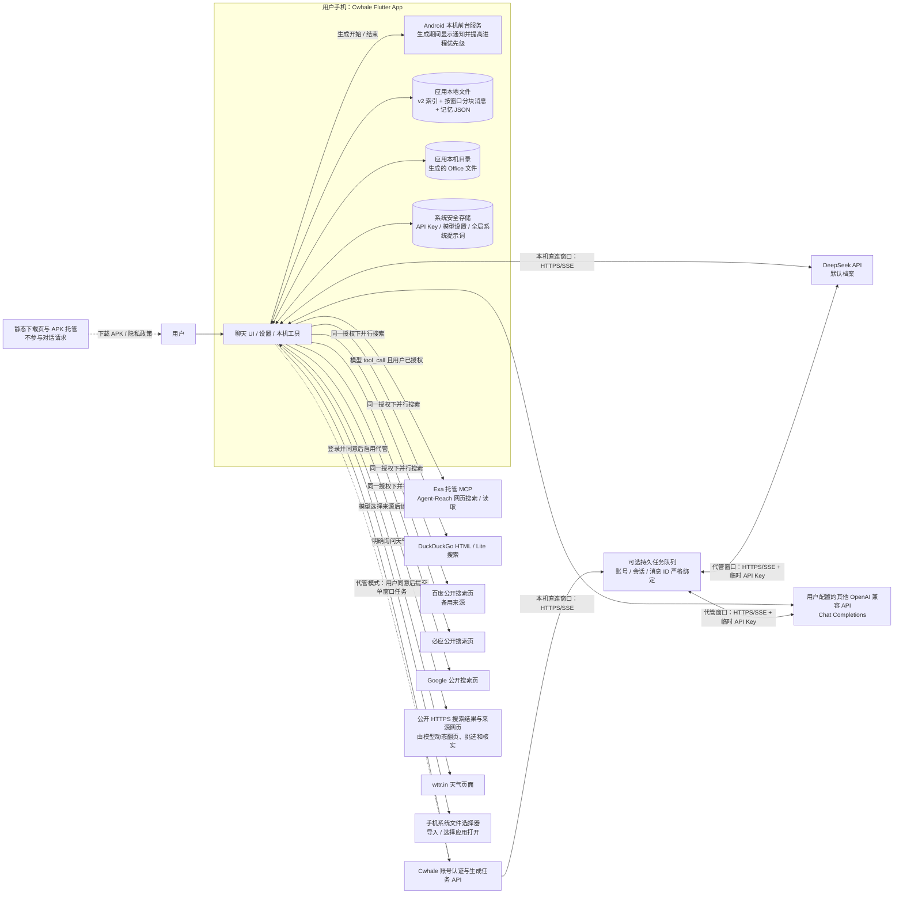

## 图 2：App 页面与导航结构

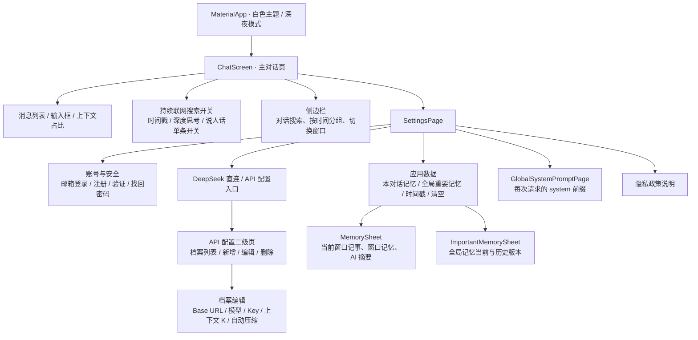

## 图 3：Flutter 模块依赖

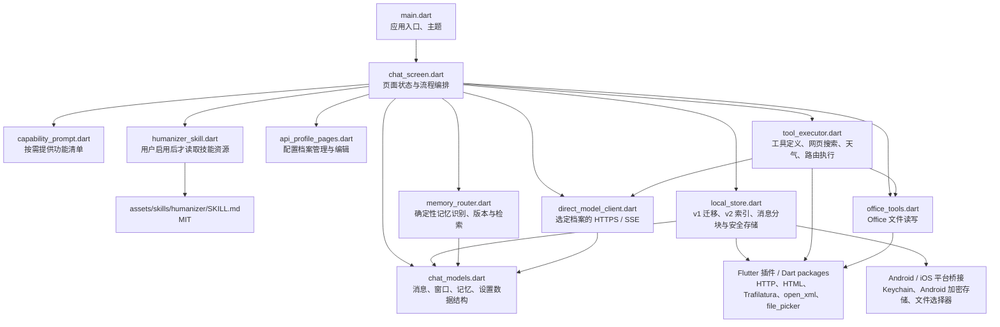

### 模块职责

| 文件 | 职责 |
| --- | --- |
| `lib/main.dart` | 建立 Flutter 应用、深色主题及系统栏样式 |
| `lib/chat_screen.dart` | 主 UI；管理窗口状态、活动消息分页、请求、SSE 展示、工具回合、压缩、设置入口 |
| `lib/capability_prompt.dart` | 用户询问应用能力时提供功能清单 |
| `lib/humanizer_skill.dart` | 用户打开「说人话」后才从应用资源读取 Humanizer 提示词；未启用时不加载、不注入 |
| `lib/chat_models.dart` | `ChatMessage`、带 `apiProfileId` 的 `ChatThread`、`ApiProfile`、重要记忆及设置序列化结构 |
| `lib/api_profile_pages.dart` | API 档案列表、默认档案选择、添加/编辑/删除确认及每档上下文窗口设置 |
| `lib/local_store.dart` | `chats-v1.json` 一次性迁移、`chats-v2.json` 索引、按窗口消息分块、重要记忆和安全存储读写 |
| `lib/memory_router.dart` | 基于关键词的捕获、主题键、追加版本及检索 |
| `lib/direct_model_client.dart` | 按对话档案生成 OpenAI 兼容 Chat Completions 请求；Android 将请求交给前台任务引擎执行，其他平台在当前 Flutter 引擎执行 |
| `lib/generation_protection.dart` | 启停 Android 本机前台服务、转发请求和 SSE 增量、管理并发请求 ID 与后台通知 |
| `lib/model_stream_executor.dart` | 无 UI/存储依赖的 HTTPS/SSE 解析器，在 Android 前台任务引擎中运行并读取服务商 usage |
| `lib/tool_executor.dart` | 执行模型在正式请求中调用且本轮已开放的工具 |
| `lib/office_tools.dart` | Office/文本读取，本地创建 Word/PPT/Excel 文件 |

## 图 4：普通聊天请求时序

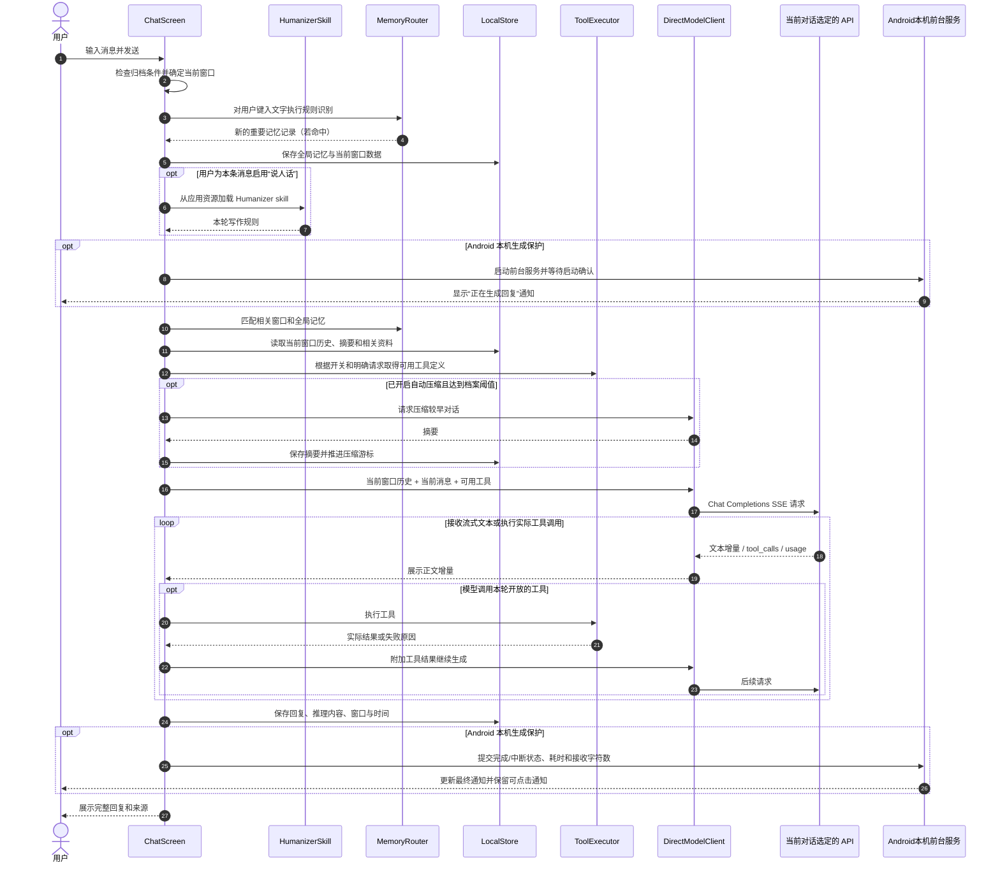

**边界说明：** 普通聊天回复通过 SSE 逐段展示。天气、时间和文件工具只在本条用户请求明确要求时提供。联网搜索开关只为当前模型请求授权；搜索不预先执行。模型判断有需要并返回 `web_search` 或 `open_web_page` tool call 后，手机才连接公开 HTTPS 来源及 Exa 托管 MCP，并将真实标题、链接、摘录或失败原因交回模型继续生成回复。搜索失败不能直接伪装成成功答案。压缩请求不带工具。用户打开「说人话」时，手机才加载随应用分发的 Humanizer skill，并将其加入本轮正式回复请求。`DirectModelClient` 会把全局系统提示词作为前缀添加到每次模型请求的 system 消息；设备本地时间戳开关打开后，每次请求还会附加本机时间 system message。模型请求和 AI 压缩均使用当前对话的 `apiProfileId` 指向的档案；新对话使用默认档案。所有档案仅支持 OpenAI 兼容 Chat Completions，不表示支持各服务商的专有协议。

Android 用户发起模型请求后，Cwhale 启动本机前台服务并显示持续通知；前台任务引擎在服务中执行 HTTPS/SSE 请求，手机仍直接连接所选 API，不经过 Cwhale 服务器或代理。API Key 通过应用内任务通道仅传递给当前请求，不写入文件或通知。回复增量分批转回界面引擎并由其每两秒或达到增量阈值后写入本机断点。首个响应头等待上限为 180 秒，SSE 事件间无新数据等待上限为 10 分钟；后者不是整轮生成总时限。前台服务是尽力保持，不保证用户强行停止应用、厂商强制清理、网络/VPN切换或 Doze 期间请求一定完成；Doze 仍可能暂停网络。完成后回复并入聊天记录并清理断点；错误或重启后将未完成消息标记为中断并恢复最近落盘的部分内容。设备本机另记录有限大小的生成生命周期诊断（状态、耗时、前后台变化和接收字符数），不含提示词、回复正文或 API Key。

联网 URL 必须为 HTTPS 域名，拒绝 IP 字面量、localhost、内网和本地文件。部分 VPN 会把公网站点域名解析到 `198.18.0.0/15` fake-IP 段，或返回 Dart 无法分类的合成 DNS 结果。固定配置的 Exa、DuckDuckGo、百度、Bing、Google 搜索入口使用精确主机名白名单，并继续校验 HTTPS 证书；其他结果网页仍要求 DNS 解析为公开地址，且通过 HTTPS 证书验证。

### 可选服务器代管任务

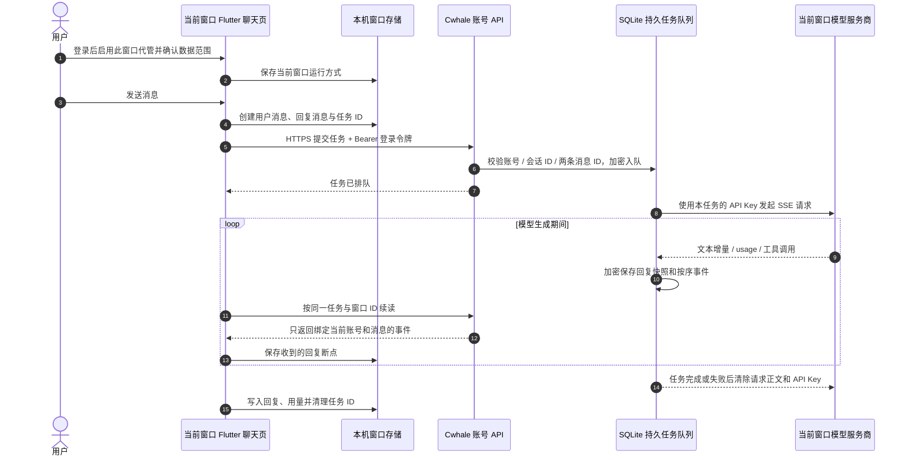

服务器队列默认上限为 10 个活动任务、每账号 2 个活动任务和 100 个排队任务。请求、API Key、最终结果和回复事件以 AES-GCM 加密保存在既有账号 SQLite 库；任务完成或失败时删除请求与 API Key，回复事件最长保留 7 天。客户端创建任务时先在本机保存 task ID；提交超时后以相同 ID 重试，避免重复扣费。客户端恢复后必须同时提供账号、窗口 ID、用户消息 ID 和回复消息 ID 才能续读，任何一项不匹配都会拒绝。服务器进程重启时，运行中的上游请求不会自动重放，以避免重复计费；队列保留的部分回复可恢复，未完成任务标记失败。免费模型不经过此队列，继续固定手机直连。

服务器代管托管的是模型 API 请求，不在服务器上执行手机文件、网页搜索等本机工具；如果回复需要这类工具，应用恢复后才会执行工具并提交后续请求。

## 图 5：上下文拼装与 AI 压缩

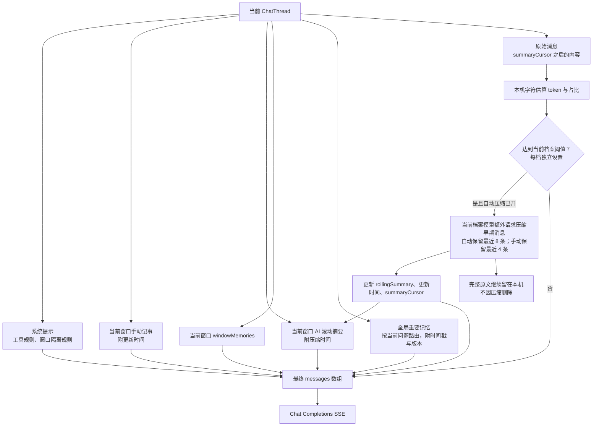

占比是本机字符估算（中文字符近似 token，其他字符按比例估算并加余量），不是服务商返回的精确 token 数。上下文窗口可按 API 档案选择 16K、32K、64K、128K、256K、512K 或 1M；占比和自动压缩阈值跟随当前对话档案。

## 图 6：两层本地记忆与版本结构

```mermaid
flowchart LR
  INPUT[本轮用户键入文字]
  MANUAL[设置页手动输入主题与内容]
  OPT{明确要求不要记录？}
  SPLIT[按标点切分句子<br/>忽略短片段]
  CLASS[固定规则分类<br/>个人特征 / 计划目标 / AI称呼 / 个人事件 / 关系事件]
  KEYWORDS[固定主题词 + 英文词 + 数字 + 中文双字关键词]
  MATCH[同类别关键词相似度匹配<br/>阈值 0.42]
  SAME{匹配已有主题？}
  VERSION[创建新记录<br/>时间戳、类别、关键词、sourceWindowId、supersedesId]
  WINDOW[(当前 ChatThread.windowMemories)]
  GLOBAL[(important-memories-v1.json)]
  MANUALKEY[创建手动主题版本<br/>manual:主题 / 时间戳 / 关键词]
  QUERY[后续用户问题]
  RETRIEVE[合并窗口 + 全局记录<br/>按关键词 / 类别匹配，最多 12 条]
  HIST{包含“之前 / 上次 / 历史”等？}
  LATEST[只选每个主题最新版本]
  OLDER[选中主题的历史版本]
  PROMPT[注入带时间戳的记忆提示和全局 system 前缀]

  INPUT --> OPT
  OPT -->|是| SKIP[本条不新增自动记忆]
  OPT -->|否| SPLIT
  SPLIT --> CLASS
  CLASS --> KEYWORDS
  KEYWORDS --> MATCH
  MATCH --> SAME
  SAME -->|是，原文有变化| VERSION
  SAME -->|否| VERSION
  VERSION --> WINDOW
  VERSION --> GLOBAL
  MANUAL --> MANUALKEY
  MANUALKEY --> GLOBAL
  QUERY --> RETRIEVE
  WINDOW --> RETRIEVE
  GLOBAL --> RETRIEVE
  RETRIEVE --> HIST
  HIST -->|否| LATEST
  HIST -->|是| OLDER
  LATEST --> PROMPT
  OLDER --> PROMPT
```

命中记录存入来源窗口和全局文档，检索时按 ID 去重。用户明确设定的 AI 称呼作为稳定交互偏好记录，并随后续请求提供；更改时追加同主题版本。常规更新追加历史版本；用户在全局重要记忆页按主题确认删除时，会物理删除该主题的全局历史版本及所有窗口副本，不创建覆盖记录。附件正文与助手回答不参与自动记忆识别。

### `ImportantMemoryRecord` 字段结构

```text
ImportantMemoryRecord
├── recordedAtUtc       UTC 时间
├── timestampLabel      设备本地时间、时区标签
├── id                  唯一记录 ID
├── key                 主题版本键
├── category            规则命中的记忆类别
├── content             命中的用户原句
├── keywords[]          本机生成的匹配词
├── sourceWindowId      来源 ChatThread ID
└── supersedesId?       被本版本更新的上一条记录 ID（不删除上一条）
```

## 图 7：本地数据结构与存储位置

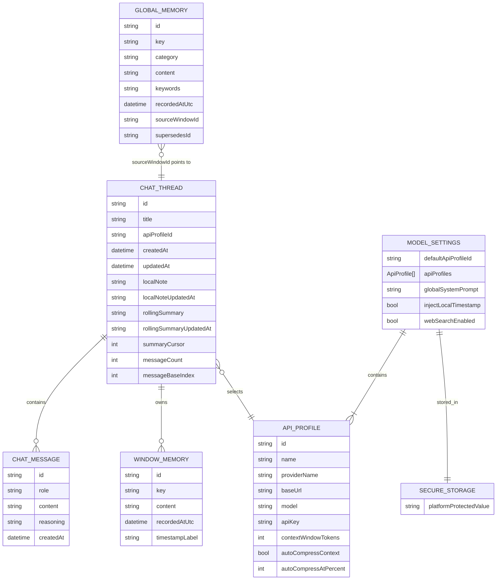

| 数据 | 实际位置 | 静态存储保护 |
| --- | --- | --- |
| 聊天标题、摘要、窗口记忆和元数据 | 应用支持目录中的 `chats-v2.json` | 本地 JSON；不由应用层加密；平台自动备份已排除 |
| 完整聊天正文、推理和文件卡片元数据 | `threads/<窗口 ID>/messages-*.json`，每块最多 100 条 | 本机分块 JSON；页面首次读最近 60 条，之后每页读 30 条；迁移成功后删除旧 `chats-v1.json` |
| 导入文档原文 | `threads/<窗口 ID>/documents/<文档 ID>/source.txt` | 原文仅在本机归档，摘要或压缩不会替代或删除原文 |
| 文档摘要、切片边界、关键词索引、任务状态和修订版 | 同一文档目录中的 `metadata-v1.json` | 本机 JSON；已完成切片逐片保存，失败后可重试 |
| 全局重要记忆 | 应用支持目录中的 `important-memories-v1.json` | 本地 JSON；不由应用层加密；平台自动备份已排除 |
| API 档案、API Key 与设置 | `flutter_secure_storage` | Android RSA-OAEP 包裹密钥 + AES-GCM；iOS Keychain 且 `synchronizable=false` |
| Office 导入临时文件 | 系统临时目录 | 读取后清理；文本文档转入对应本机文档归档，不把整份长文放入聊天正文 |
| Office 生成文件 | 应用支持目录中的 `generated_files/` | 本机保存；聊天消息保存文件路径、名称、类型与大小 |

## 图 8：本机工具与第三方数据流

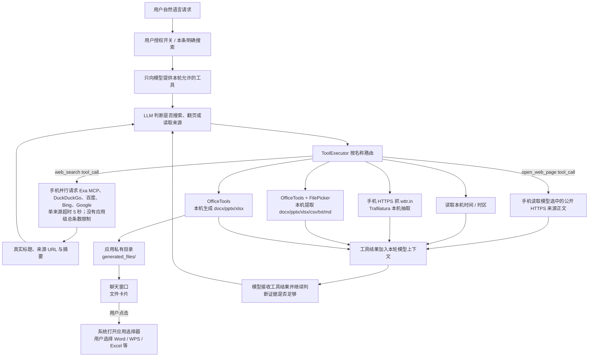

天气、时间和 Office 工具仅在本条消息命中明确请求时才提供工具定义。联网搜索开关只授权本轮模型自行判断是否需要搜索；开关关闭时，只有用户明确提出搜索才提供搜索工具。模型通过 Exa 语义搜索和并行搜索来源、调整查询、读取来源来核实证据，达到足够可信度后自行停止；应用不设 3 条或 25 条的总结果上限，也不会把搜索页直接当成助手回答。搜索候选页和读取到的正文都作为工具结果交给模型综合生成回答。手机通过 HTTPS 直接连接 Exa MCP 与被选中的搜索/网页来源；相应第三方会收到查询词或读取目标 URL，Cwhale 不代理这些流量。Agent-Reach 本身是 Python CLI，未被打包进移动应用；Cwhale 仅采用原生 Dart HTTP 请求调用 Exa 的托管 MCP。

## 图 9：数据与密钥信任边界

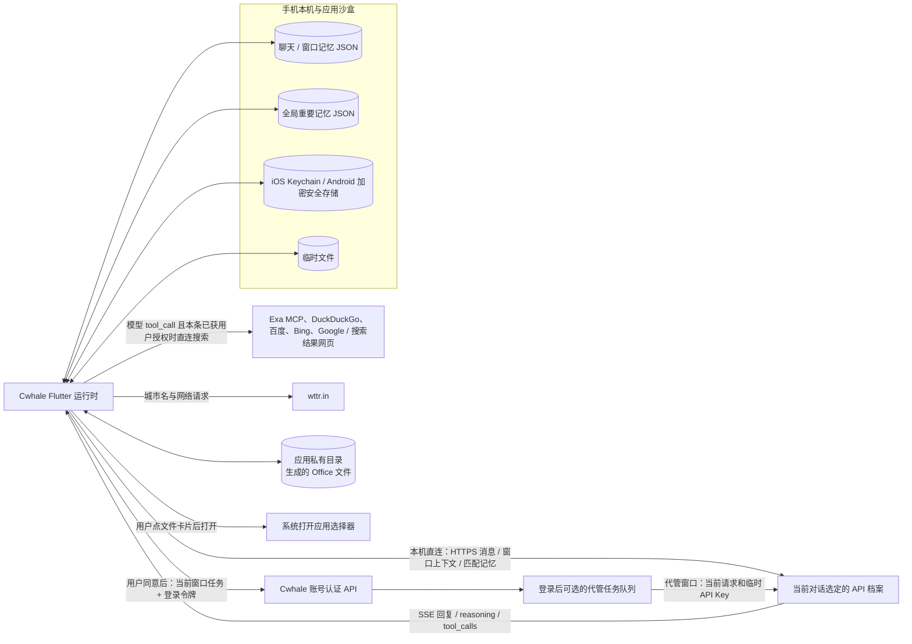

### 数据出境/上传规则

- 默认直连模式不发送聊天或模型 API Key 到 Cwhale 服务器；请求直接发给当前对话选定的 API。
- 用户登录并明确选择服务器代管后，仅当前窗口的消息、必要上下文、可能产生的工具定义/结果与该档案 API Key 发给 Cwhale 任务队列，再转发至模型服务商。任务严格绑定账号、窗口、用户消息和回复消息 ID；服务器加密暂存，完成或失败后清除请求与 API Key，回复事件最多保留 7 天。
- 登录认证本身只处理邮箱、密码哈希、验证和会话，不读取聊天或记忆。免费模型固定走手机直连，不经过代管队列。
- 只有持续搜索开关开启或本条明确要求搜索时，模型才可调用搜索工具；该工具被调用后，手机访问 Exa MCP、DuckDuckGo、百度、Bing、Google 或被选中的目标网页。天气仍需本条明确请求。
- Office 文件首先在本机读写；文档摘要所需的原文或切片由手机直接发给当前对话档案，模型普通对话只收到本机总览和匹配的摘要。生成文件保存在应用本机目录并以聊天文件卡片显示，用户点卡片后由系统选择其他应用打开。
- Android manifest 禁止自动备份；iOS AppDelegate 将应用支持目录标记为排除备份。Keychain 项设置为不同步。

## 图 10：构建与分发路径

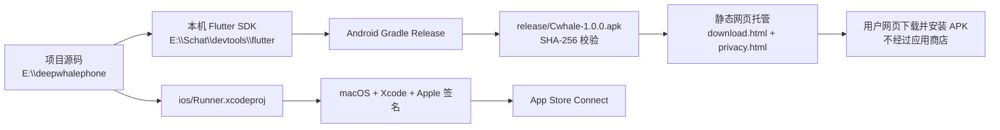

Android Release APK 和静态下载页已在仓库中；iOS 项目已生成，但 App Store 签名/上传需要 macOS、Xcode 和 Apple Developer 配置。静态下载站只托管安装包与隐私政策，不接入 API 对话链路。

## 图 11：本机聊天分页与旧数据迁移

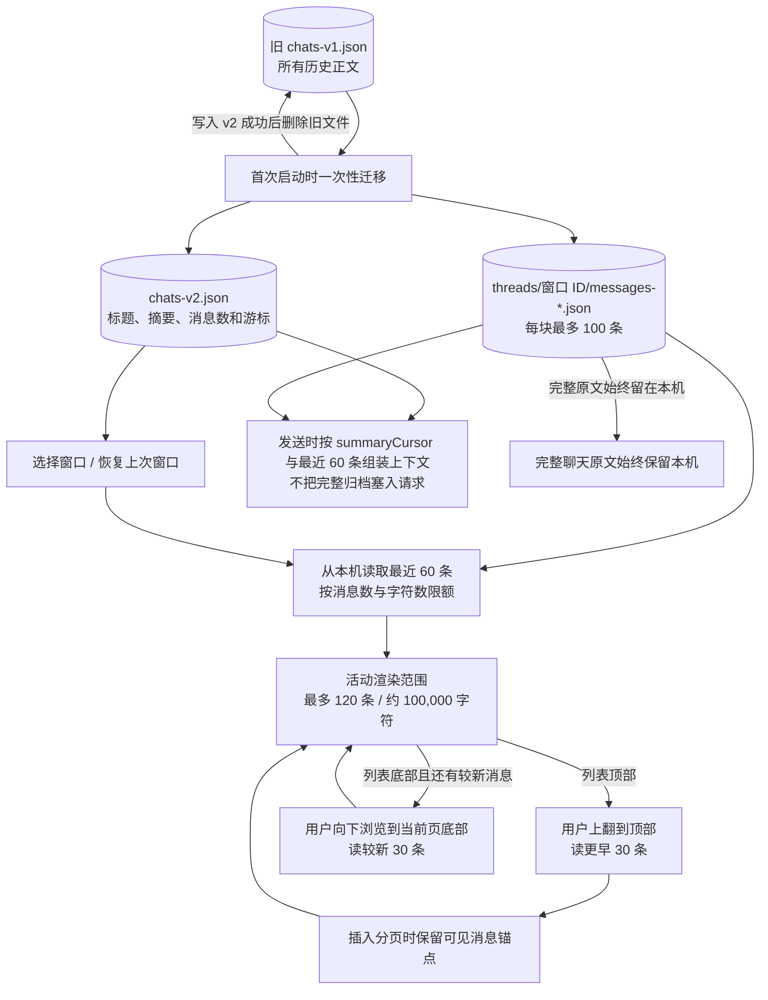

切换或恢复对话时每个窗口使用独立滚动控制器，首次布局后落到最后一条。用户上翻时不会因流式增量自动跳回底部；键盘调整高度时，原本处于底部的列表保持最新内容可见。聊天正文分页只控制 UI 活动范围；模型请求使用摘要游标之后、最近最多 60 条消息，并按相关性注入本地记忆，不把完整归档或全部历史正文塞入请求。

## 图 12：上下文阈值归档与按需接续

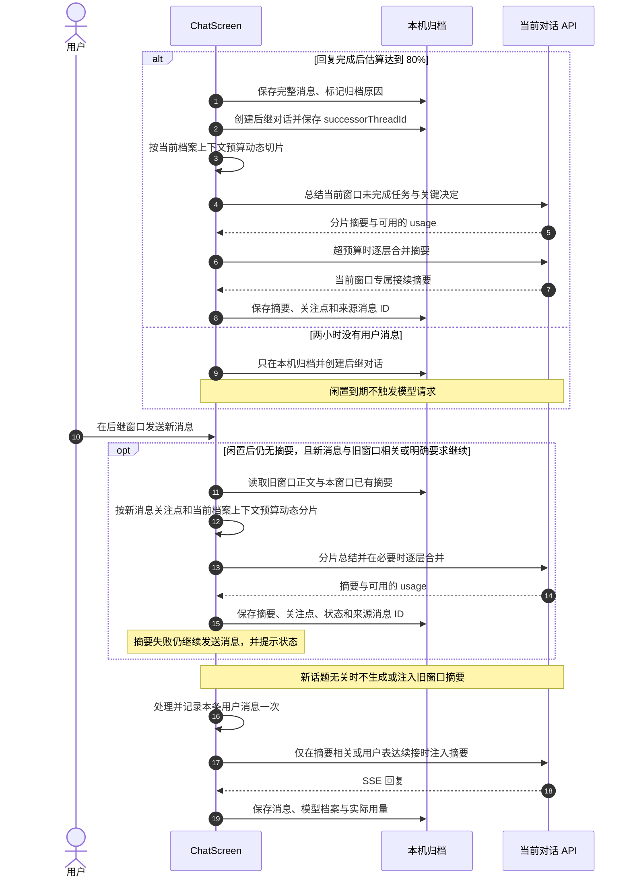

自动归档和手动压缩是两条不同路径：手动压缩只更新当前窗口摘要游标；自动归档保留全部原文并创建新的活动窗口。两者都不删除原始消息。阈值按当前对话档案估算；系统提示词、近期消息和本机注入的相关记忆计入估算。接续摘要按当前模型上下文、提示开销、摘要输出预留和安全余量动态确定是否分片，小窗口／小对话不套固定切片长度；每片优先在段落和句末切分，分片摘要超出合并预算时逐层归并。摘要围绕当前窗口仍需延续的目标、约束、决定和进度生成；闲置后只有用户继续相关话题或明确要求继续时才触发摘要生成，无关新话题不会加载旧摘要。摘要、窗口/全局记忆和归档搜索摘录共同受最多 2,000 tokens 且不超过当前上下文 5% 的注入预算限制。

## 图 13：AI 回复版本、用量和消息操作

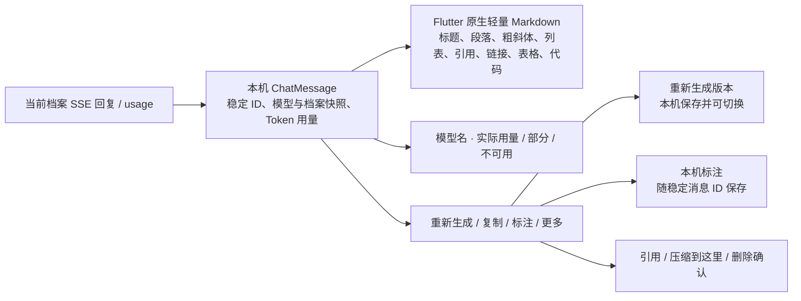

流式 `usage` 由直连客户端解析。包含工具调用的单次回复会合并本轮每个模型请求的 usage；若服务商没有提供或只返回部分字段，则 UI 标记为部分或不可用。历史消息保留当时档案、服务商、模型及用量快照。代码块和宽表格各自在消息区域横向滚动，Markdown 不通过 WebView 渲染。API 思考菜单仅依据档案中显式保存的思考开关/档位能力；UI 只显示思考状态，不展示 `reasoning_content`。

## 已实现与后续边界

| 能力 | 当前状态 |
| --- | --- |
| DeepSeek 直连、SSE 流式回复、DeepSeek thinking 参数 | 已实现 |
| 窗口隔离记忆、全局重要记忆、规则路由、时间戳和版本保留 | 已实现 |
| 手动 AI 摘要与占比阈值自动压缩 | 已实现 |
| 长文档本机归档、按当前档案预算动态切片、逐片摘要、分层归并与关键词按需检索 | 已实现 |
| 80% 上下文归档并为当前窗口生成动态预算的接续摘要；两小时闲置仅本机归档、相关续聊时才生成摘要 | 已实现 |
| 回复用量与档案快照、重新生成版本、标注、删除和定位操作 | 已实现 |
| 原生轻量 Markdown、输入附件预览、会话模型选择与思考档位配置 | 已实现 |
| 接续摘要、记忆、归档历史命中的联合注入预算 | 已实现 |
| 明确意图触发搜索、天气、时间、Office 工具 | 已实现 |
| 搜索开关手机直连检索、并行备用来源、真实引用与明确失败状态 | 已实现 |
| 本机重要记忆严格路由、按主题删除所有版本及窗口副本 | 已实现 |
| chats-v1 无损迁移、按窗口分块和活动消息分页 | 已实现 |
| 本机 JSON 聊天/记忆；本机安全存储 API Key | 已实现 |
| Cwhale 邮箱账号注册、验证、登录与找回 | 已实现 |
| 登录后可选的服务器代管队列、并发上限、加密存储和绑定续接 | 已实现，需部署后配置公开 HTTPS 地址 |
| 向量数据库、Embedding、RAG、会员增值与跨设备聊天同步 | 未实现，后续范围 |

## 图 14：文档本机分层摘要与按需回读

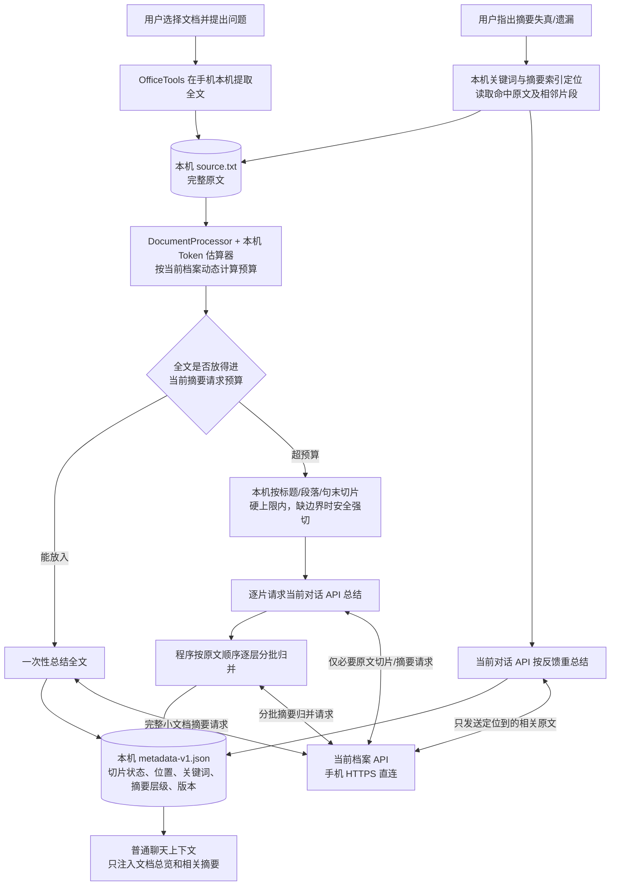

文档请求使用独立精简提示，不携带无关聊天历史或工具定义。上下文上限记为 `C`；本机为每次请求估算固定提示开销 `H`、摘要输出预留 `R` 和安全余量 `M`，输入预算为 `B = C - H - R - M`。`R` 默认取上下文的 5%，限制在 2K–32K；`M` 默认取上下文的 2%，至少 512 tokens。`T ≤ B` 时整篇只发一次；`T > B` 时才切片，目标不超过预算的 90%，单片不越过硬输入上限。切片优先靠近标题、段落或句末边界，最多延伸目标长度的 10%；仍没有边界时在安全字符位置强制切片并记录偏移。每次切片完成后立即保存，恢复处理会跳过已完成片段。摘要集合超过单次预算时逐层分组归并。总览、相关章节摘要和其他本机记忆共同受每次聊天请求最多 2K tokens 且不超过所选模型上下文 5% 的注入预算约束。原文始终留在本机；摘要、关键词索引和切片信息均为可重建派生数据。
