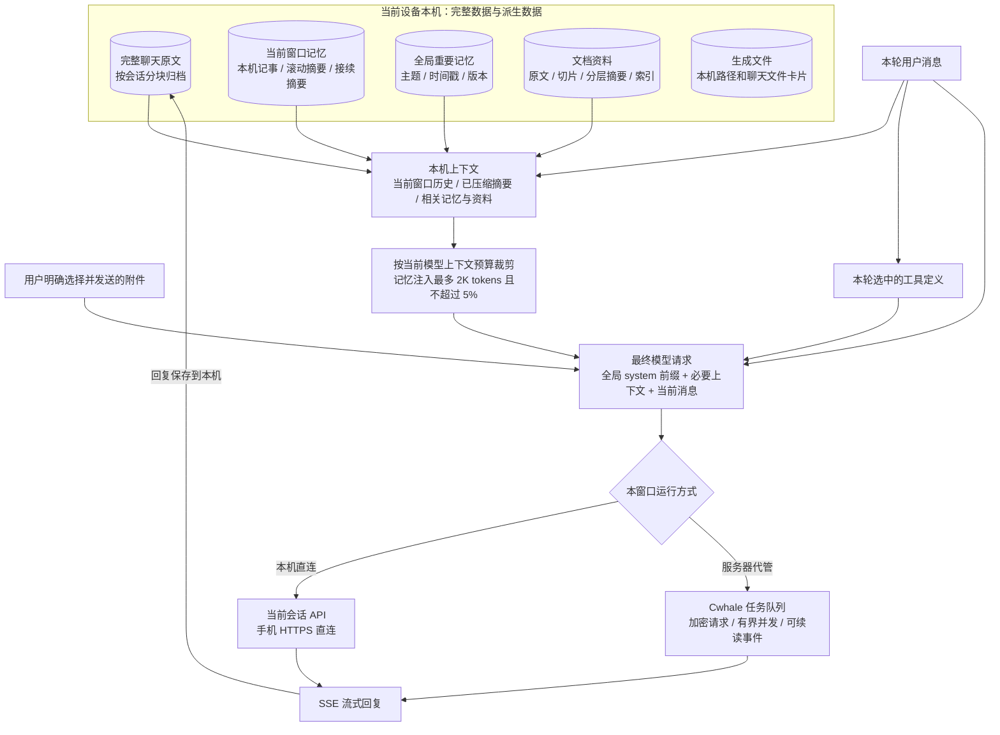
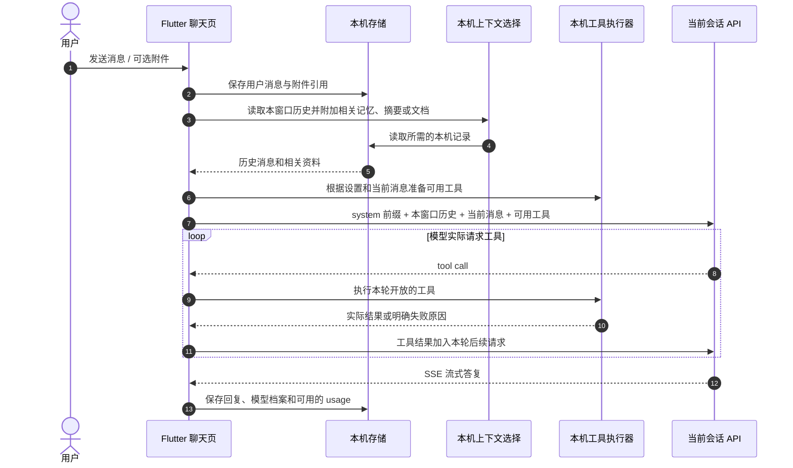
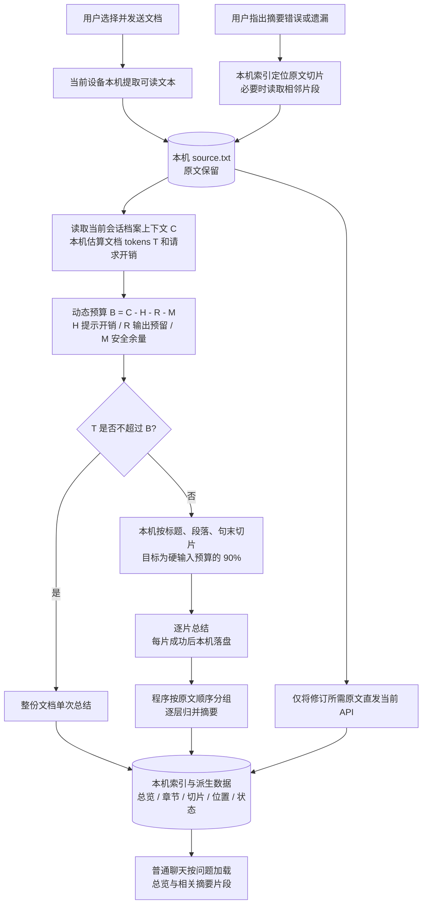
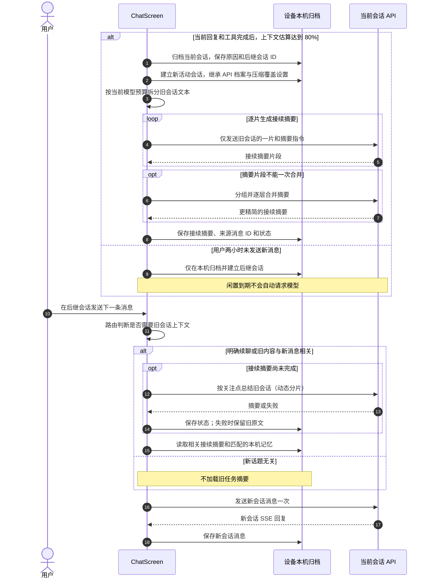
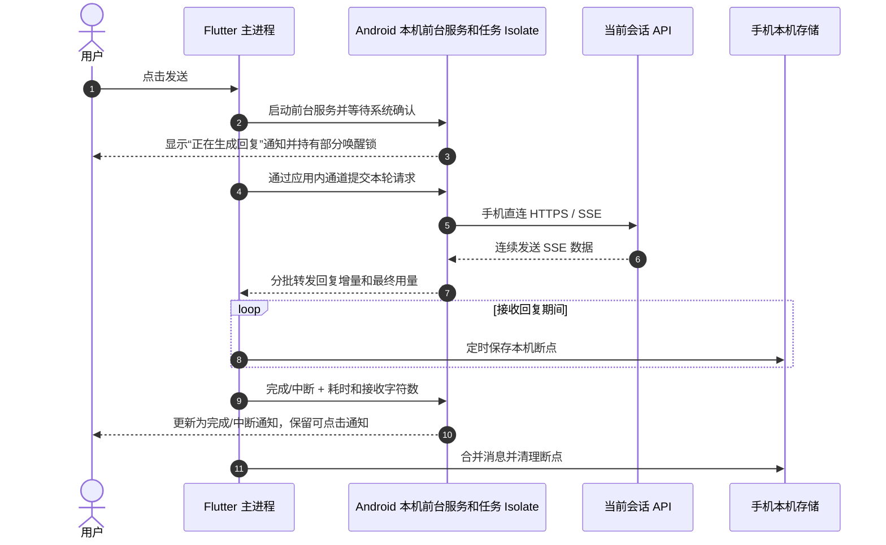

# Cwhale

一款以 DeepSeek 为默认方案的本地优先 Flutter AI 对话客户端。Android、iOS 和 Windows 客户端直接连接当前对话选定的服务商 API；应用没有自有 API 转发或聊天存储服务。

项目当前架构、数据流、存储边界和发布路径图见 [ARCHITECTURE.md](ARCHITECTURE.md)。

## 当前版本

- 默认配置为 DeepSeek 与 `deepseek-flash`；设置二级页可添加、编辑和删除其他 API 档案，对话窗口可分别选择档案。兼容档案仅实现 OpenAI 兼容 Chat Completions，不代表支持服务商专有协议。
- 每档独立保存显示名、服务商、Base URL、模型、API Key、上下文上限和自动压缩设置。上下文窗口可设 16K、32K、64K、128K、256K、512K 或 1M；新对话使用默认档案，既有对话保持自己的选择。
- 每个窗口独立保存运行方式，默认本机直连。直连时 API Key 只保存在本机安全存储并直接发给当前窗口的模型服务商；可在本窗口设置中选择服务器代管，新对话默认值也可在应用设置中配置。代管需登录并确认数据范围，消息、必要上下文和该档案 API Key 会通过 HTTPS 发给 Cwhale 服务器代转发。Cwhale 免费模型固定本机直连。
- API 协议：`POST {Base URL}/chat/completions`，JSON 请求包含 `model`、`messages` 和 `stream: true`；需要时附带 `tools`；响应为 `text/event-stream`（SSE）并逐段展示。DeepSeek 深度思考只对 DeepSeek API 发送 `thinking` 参数。
- Cwhale 邮箱账号支持注册、邮箱验证、登录、密码找回和退出。登录本身只处理账号认证；启用服务器代管时才会将当前窗口的请求发往 Cwhale 任务队列。登录后可以启用 Cwhale 免费模型，实际可用额度由免费模型服务端提供，免费模型请求不经过 Cwhale 任务队列。
- 输入框下方提供可选的「说人话」按钮，集成 MIT 许可的 Humanizer skill。开启后只为下一条消息加载完整写作规则；关闭时不读取、不注入模型请求。启用会增加本轮提示词 Token。技能规则随正式回复请求发送。
- 完整对话、每个窗口独立的窗口记忆、手动记事和滚动摘要只保存在应用本机。旧版 `chats-v1.json` 会无损迁移；`chats-v2.json` 索引和分块消息成功保存后，旧文件才会删除。此后由 `chats-v2.json` 保存索引、`threads/<对话 ID>/messages-*.json` 分块保存原文。聊天页最近加载 60 条，向上每页追溯 30 条，活动范围最多 120 条且正文约 100,000 字符；分页不删除原文，也不替换模型上下文规则。
- 全局重要记忆单独保存在本机 `important-memories-v1.json`，由确定性的关键词路由识别个人特征、计划、个人事件、真实关系事件和用户为 AI 设定的称呼；也可在全局记忆页手动填写主题和内容。手动记忆与自动记忆都带本地时间戳及版本关系；同主题更新会追加新版本，AI 称呼始终随请求提供，其他记忆按当前问题匹配。路由详见 [MEMORY_ROUTING.md](MEMORY_ROUTING.md)。
- 记忆路由会排除普通问句、搜索请求、假设/角色扮演、普通 AI 操作指令以及只出现“我/今天/以后”的内容；用户明确指定 AI 称呼时会作为稳定交互偏好记住。全局重要记忆可按主题删除；删除同步清除所有历史版本和各聊天窗口中的副本。
- 完整聊天原文的主副本始终留在当前设备。服务器代管时，当前请求会在服务器端加密排队，任务结束后删除请求正文和 API Key；加密回复事件最长保留 7 天供断线续接。输入框按当前对话档案显示上下文占比；用户可按“压缩”让当前档案模型压缩较早对话，也可在档案中设置自动压缩开关和触发阈值。后续请求只使用当前窗口选出的记事、摘要、窗口记忆、相关全局重要记忆和近期原文。
- 侧边栏可导入 DeepSeek 官网导出的对话 ZIP，也可粘贴公开 HTTPS 下载链接。ZIP 在本机解析，按导出中当前选中的消息分支恢复为独立对话；小图片随记录保存在本机。导入不会覆盖原对话，单个 ZIP 最大 128 MB；可选把导入会话归入命名文件夹。
- 新建对话仅作为临时窗口存在；用户发送首条消息后才写入本机索引并显示在侧边栏。恢复旧数据时会从列表清理没有消息、摘要、记忆、附件或其他本机内容的空对话。
- 支持本机选择 .docx、.pptx、.xlsx、.csv、.txt、.md 文件；提取文字仍留在本机，用户点击发送后才随消息直连当前对话选定的 API。模型生成的 Word、PowerPoint 和 Excel 文件保存在应用本机目录，并作为聊天文件卡片显示；点击卡片后交给系统选择可打开的应用，不内置编辑器。
- 智能联网搜索：开关默认关闭，用户打开后保持开启直到手动关闭；开关只把工具交给本轮模型，由模型判断是否搜索、是否继续和何时停止。模型发起 `web_search`，客户端并行直连 Agent-Reach 使用的 Exa 托管 MCP 与 DuckDuckGo、百度、Bing、Google 公开搜索页；模型按需选择来源并通过 `open_web_page` 核实正文。应用没有固定总结果条数，模型根据证据质量自行决定继续或停止。搜索候选和网页正文作为工具结果交给 LLM 分析综合，不会由程序直接返回网页列表。Exa 不可用时仍会尝试其他来源，所有失败原因会交给模型，不伪装成功。打开网页时先由客户端直连 Exa 获取正文，失败后直连原网页并用 Trafilatura 本机提取。Agent-Reach 的 Python CLI 不打包进 App，也不需要 Cwhale 服务器。
- 天气工具固定抓取 wttr.in 的天气网页；客户端直连网页，并用本机 Trafilatura 提取当前天气和预报，不需要天气 API Key。天气结果附抓取时间和来源页面。
- 输入框旁可手动切换本地时间戳和 DeepSeek 深度思考；思考模式按 DeepSeek API 参数启停，推理上下文只在本机保存并按需直连 DeepSeek。
- 设置页二级界面可配置全局系统提示词；保存后作为 system 前缀加入每次模型请求，包括工具后续请求和摘要压缩请求。内置身份提示会在询问模型身份时回答：“我是 Cwhale，背后具体的服务商由您当前激活的 API 为准。”
- “每次请求附带本地时间戳”在设置里手动开启，默认关闭。开启后每次模型 API 请求都包含设备本地日期、时间、时区，包括工具调用和记忆摘要请求；时间戳不保存进聊天记录。
- 暂不含 RAG、向量库、会员系统或遥测。账号认证不读取聊天。服务器代管使用现有账号 API 的持久化任务队列：默认最多 10 个同时运行、每账号最多 2 个、最多 100 个待排队任务；任务严格绑定账号、窗口、用户消息和回复消息 ID。请求和事件在 SQLite 中用由服务端 secret 派生的 AES-GCM 密钥加密；每个模型请求完成或失败后清除排队请求与 API Key。进程重启时，未完成的上游请求标为失败而不自动重发，避免重复计费。
- 用户手动检查更新时，Android 客户端查询 GitHub Releases 并由系统浏览器下载 APK；Windows 和 iOS 客户端会在系统浏览器打开公开发行页。此过程不发送聊天、记忆、API Key 或文件。
- 第三方开源依赖许可见 [THIRD_PARTY_NOTICES.md](THIRD_PARTY_NOTICES.md)。
- 模型设置页内提供隐私政策与数据说明；发布前需将 PRIVACY.md 的发布者和联系方式补齐，并托管为公开 HTTPS 页面。

## 上下文架构与工作流程

下面的图按当前代码描述运行时行为。聊天原文、摘要、记忆、文档和检索索引保存在本机；每个窗口独立选择由手机直连，或经登录后的 Cwhale 队列代管模型请求。

### 上下文分层

- 完整历史只保留在本机归档。聊天页首次载入最近 60 条消息，向上追溯时每页读 30 条；活动渲染范围限制为最多 120 条及约 100,000 个正文字符。UI 分页和模型上下文是两套范围：模型请求不会因为本机保留完整记录就自动附带全部历史。
- 普通聊天直接用当前窗口历史和新消息生成回复。默认最多保留最近 64 轮原文，更早的对话统一用摘要承接。历史正文达到模型容量的 80% 时会在后台压缩，也可手动选择「压缩全文」。两种压缩都按 5:3 分割当前历史正文，较早部分做摘要，较新部分保留原文，切点按完整轮次向前对齐。Token 面板的「32K 激进模式」可进一步降低本会话上限。
- 搜索开关打开或用户明确要求联网时，提供联网工具。天气、时间和文件工具按当前消息的明确请求提供。模型在正式请求中决定是否调用，实际执行后才追加工具结果继续生成。
- 相关记忆、记事和文档摘要仍按问题加载。明确询问旧聊天时才检索本机归档。全局系统提示词和本地时间戳继续按当前设置附加。
- 当前模型的上下文窗口按会话所选 API 档案计算。接续摘要、记忆和历史检索摘录共用注入预算：最多 2,000 tokens，且不超过上下文上限的 5%。相关性不足的记忆或文档摘要不会因保存在本机而自动全部送入模型。

### 一条消息如何进入模型

工具调用可能产生额外请求。模型服务商没有返回 `usage` 时，应用不会把本机估算冒充为实际用量。

### 长文档本机归档、动态切片与回读

文档总结使用精简请求，不带无关聊天历史或工具定义。当前实现按模型档案动态计算预算：`R = clamp(上下文的 5%, 2K, 32K)`，`M = max(上下文的 2%, 512 tokens)`；`H` 包括全局提示、摘要指令、文档定位信息和协议余量。文档能放入当前预算时一次总结；超出预算才切片。切片目标不超过硬输入预算的 90%，优先在章节、段落或句末结束；允许为找自然边界延长最多 10%，仍找不到时在安全字符处强制截断并记录原文位置。每片摘要按顺序分批归并，摘要集合过大时继续逐层归并。

文档原文、切片、摘要层级、索引和任务状态都留在对应会话的本机目录；中断后可跳过已完成切片继续处理。日常消息只加载文档总览和相关章节/切片摘要。用户指出摘要失真时，应用按反馈在本机定位原文并只回读相关范围，再让当前 API 修订摘要；无法定位会要求补充章节、人物或具体错误点。摘要和索引是可重建派生数据，压缩、归档和重试都不会删除原文。

### 上下文达到阈值后的归档与接续

- 80% 阈值按当前会话 API 档案估算。当前回复和工具调用完成后，应用只切换一次：保留旧会话全部原文、创建后继会话，再为旧窗口生成接续摘要。若下一条消息预计会超阈值，会先在本机建立后继会话，再把该消息只写入新会话一次。
- 两小时以最后一条用户消息时间计算。应用前台计时到期时，或应用恢复/下次发送时，只在本机归档并建立新会话；不在没有用户操作时调用模型。下次用户明确说“继续”等，或问题与旧会话相关时，才按当前 API 动态分片生成未完成的接续摘要；生成失败仍发送新消息并提示摘要状态。
- 自动归档与手动压缩不同：手动压缩在当前会话更新 AI 滚动摘要游标；自动归档保留原文并新建会话。两者均不删除聊天原文。新话题无关时不带入旧任务摘要；记忆与摘要按需检索并受注入预算限制。

### Android 后台生成与通知

Android 本机直连模式使用独立 Flutter 前台任务引擎执行 SSE；该模式下手机直接连接所选 API，系统强制清理时无法恢复未接收数据。服务器代管模式不依赖手机持有上游 SSE：登录并同意后，当前窗口的请求交给持久任务队列，应用恢复后按原窗口及消息 ID 续读回复事件。服务器未完成任务不会因重启自动重发。

服务器代管持有的是当前模型 API 请求；若回复需要手机本机文件、网页搜索等工具，应用恢复后才会执行这些工具并继续后续模型请求。

完整系统架构（页面导航、模块依赖、存储结构、信任边界、工具数据流、迁移和发布图）见 [ARCHITECTURE.md](ARCHITECTURE.md)。数据发送和保留说明见 [PRIVACY.md](PRIVACY.md)。

每次生成回复时，实际选中的上下文和当前用户消息会按当前窗口运行方式发送：本机直连直接发送到所选 API；服务器代管先发送至 Cwhale 任务队列再转发。手动/自动压缩、文档摘要和接续摘要会产生额外模型请求，并可能产生额外费用；摘要保存在本机，原始聊天不删除。上下文占比由本机估算，仅供参考。请确认对应服务商的数据处理规则和 API 计费方式。

用户开启「说人话」后，Humanizer skill 提示词会与本轮最终回复请求一起由客户端直发当前 API；未开启时不会加载到模型上下文。提示词文件随应用安装包本地分发，不需要额外依赖或服务。

联网搜索时，只有模型在用户授权后调用工具才会联网；关键词和被选中的来源网页会直接发给对应公开站点。模型自行决定翻页、改写查询和读取来源，并在可信证据足够后停止，没有固定的搜索结果总条数。搜索结果进入本轮所选 API 上下文，由模型生成综合答复；聊天中的引用以蓝色短链接显示，点击后交给系统浏览器打开。天气查询时，城市名称和设备网络地址会随直接网页请求发送给 wttr.in；天气正文在本机提取，并作为工具结果发送给当前所选 API。请查看相应服务的隐私规则；服务站点可能限流或暂时不可用。附件文字仅在用户发送后才交给当前所选 API。Office 导出文件由设备本机生成。

注意：API Key 由用户在客户端运行时输入，不会打包进安装包，也不会明文写入应用文件。请妥善保护设备和剪贴板；设备或操作系统遭到攻破时，系统安全存储中的密钥仍可能泄露。发布前应确认客户端直连方式符合 DeepSeek 服务条款。

## 本地开发

请先在本机安装 Flutter SDK、Android SDK 和兼容的 JDK，并确保 `flutter` 命令可用。然后在 Windows PowerShell 中运行：

~~~powershell
flutter doctor
flutter pub get
flutter run
~~~

如果 Flutter 未自动发现 Android SDK 或 JDK，请在本机按实际安装位置设置 `ANDROID_HOME`（或 `ANDROID_SDK_ROOT`）和 `JAVA_HOME`。这些路径属于本机环境，不应提交到版本库。Android SDK 路径也可以保存在本机生成的 `android/local.properties` 中。

## Windows 桌面端

Windows 版本沿用 Flutter Windows runner 和现有 Flutter 页面、数据模型及模型请求流程。宽窗口会固定显示左侧对话列表，聊天内容在主区域居中；窗口较窄时自动回到抽屉导航。窗口可缩放，最小尺寸为 900 × 600 物理像素。生成的 Office 文档可交由 Windows 默认应用打开，引用链接使用默认浏览器。

聊天、记忆、附件和生成文件保存在当前 Windows 用户的本机应用支持目录，不会与手机客户端自动同步。API Key 使用 Windows Credential Manager 管理加密密钥，并以 AES-GCM 加密后保存在本机；模型请求由 Windows 客户端直接发送给当前对话选定的 API。Android 前台服务和通知只用于 Android，不会在 Windows 上注册后台服务。

开发运行：

~~~powershell
flutter pub get
flutter run -d windows --dart-define=CWHale_AUTH_BASE_URL=https://www.symbioticuniverse.com
~~~

Windows 构建需要 Flutter SDK、Visual Studio Build Tools 的“使用 C++ 的桌面开发”工作负载，以及 Windows SDK。正式构建与打包运行：

~~~powershell
flutter build windows --release
.\tool\package_windows.ps1
~~~

打包脚本默认连接 Cwhale 账号服务并注入正式账号地址；要改用测试环境，可传入 `-AuthBaseUrl https://你的测试域名`。它会生成可直接运行的 ZIP；如果安装了 Inno Setup 6，也会生成每用户安装包。安装包默认写入 `%LOCALAPPDATA%\Programs\Cwhale`，不需要管理员权限。

## Android APK

新增或更新 Flutter 依赖后，先运行 `flutter pub get`，再执行正式打包脚本。该脚本使用已解析的锁文件离线构建，不会在正式打包时再次联网解析依赖。

~~~powershell
# 正式打包自动推进补丁版本与 Android build number
.\tool\package_android.ps1
~~~

版本号以 pubspec.yaml 为准，格式为 `主版本.次版本.补丁版本+AndroidBuildNumber`。正式打包脚本默认将补丁版本和 build number 各加一，并把版本写入应用设置页和下载页；避免直接调用 Flutter 构建命令绕过版本推进。APK 输出到 `release/Cwhale-版本号.apk`。正式分发前应配置并备份自己的 Android release 签名密钥；同一个应用后续更新必须使用原签名密钥。

网页下载包已整理在 release/：将整个目录静态托管后，download.html 会提供安装包链接和 SHA-256 校验值。该下载页不参与模型 API 请求。正式公开前先补全 release/privacy.html 中的发布者和联系邮箱。

## iOS App Store

iOS 工程已生成在 ios/。App Store 构建需要 macOS、Xcode、Apple Developer 账号、签名配置、隐私政策链接和 App Store Connect 元数据。当前 Windows 环境不能生成或签署 iOS App Store 包。
